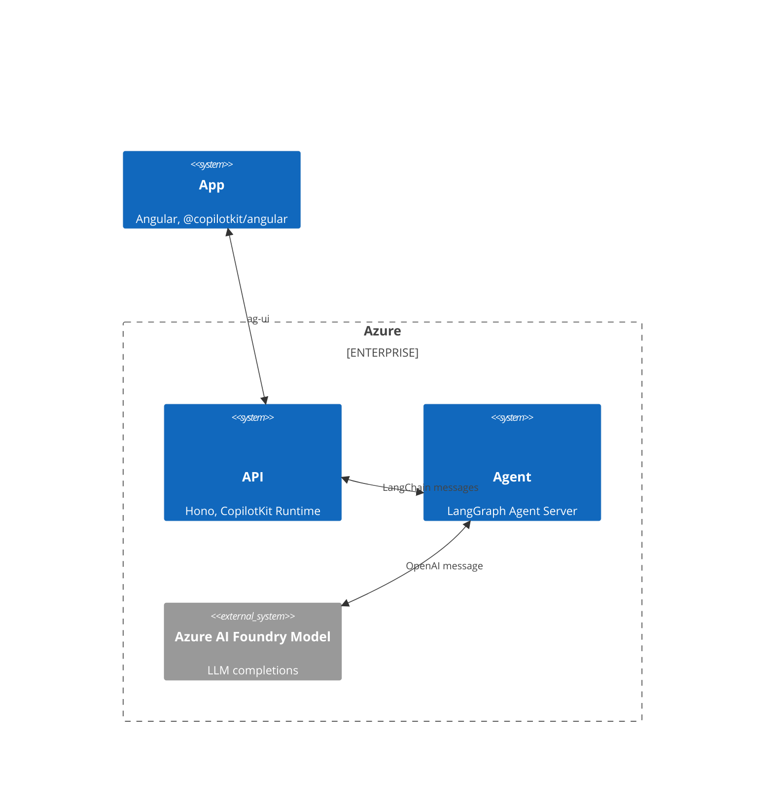
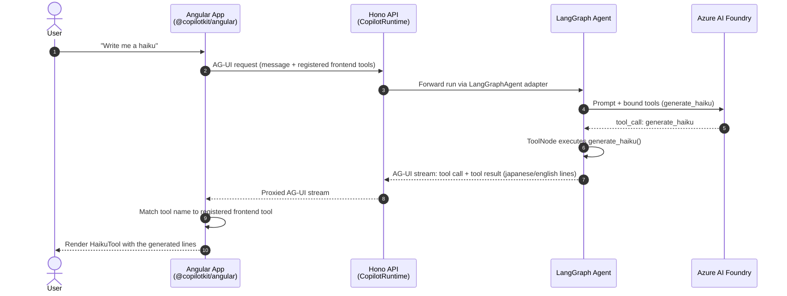
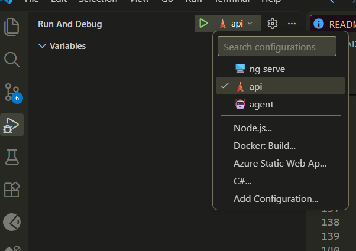
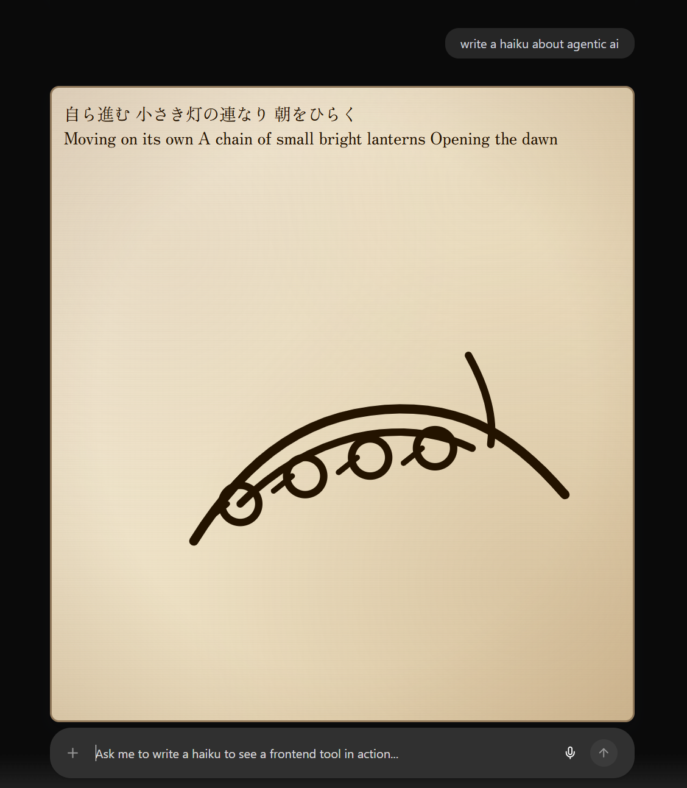
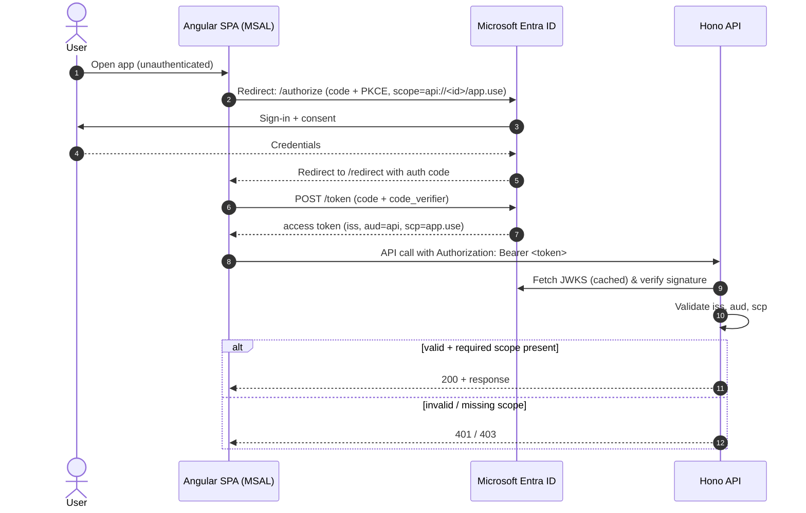

# LangChain AG-UI Angular

A streaming AI chat application with generative UI tool components, connecting an Angular (`@copilotkit/angular`) frontend to a LangGraph Server via the [AG-UI protocol](https://docs.ag-ui.com/) and `@ag-ui/langgraph` on a Hono API.

This sample demonstrates a fully self-hosted deployment on Azure Container Apps using official AG-UI and CopilotKit packages rather than a custom AG-UI protocol implementation.

- **App** — Angular 22 chat UI ([packages/app](packages/app))
- **API** — Hono gateway that bridges the UI and the agent ([packages/api](packages/api))
- **Agent** — LangGraph agent served via LangGraph.js ([packages/agent](packages/agent), [README](packages/agent/README.md))

Each service runs as its own container on **Azure Container Apps**, backed by Azure
AI Foundry (Cognitive Services) model deployments, an Azure Container Registry,
Key Vault, and Application Insights.

## Table of Contents

- [Architecture](#architecture)
- [AG-UI tool calling example](#ag-ui-tool-calling-example)
- [Prerequisites](#prerequisites)
- [Dev Container Quick Start](#dev-container-quick-start)
- [Local development](#local-development)
- [Working with the code](#working-with-the-code)
- [Clean up](#clean-up)
- [User authentication (OpenID Connect)](#user-authentication-openid-connect)
- [LangGraph config profiles](#langgraph-config-profiles)
- [Troubleshooting](#troubleshooting)
- [References](#references)

## Architecture

The core idea: a LangGraph agent, backed by an Azure AI Foundry model deployment,
talks to the browser through the **CopilotKit runtime** (hosted in the Hono API)
and the **CopilotKit Angular** client, using the **AG-UI protocol** as the wire
format between the App and the API.

### Infra


### System design



- **App** — Angular UI using `@copilotkit/angular`. Renders the chat, streams
  assistant messages, and registers **frontend tools**. Custom Angular
  components are rendered inline for specific tool calls (for example, the haiku frontend tool included in the demo app).
- **API** — a Hono server hosting the `CopilotRuntime` from `@copilotkit/runtime`.
  It terminates the **AG-UI protocol** from the App and forwards the
  conversation to the LangGraph deployment via `@ag-ui/langgraph`'s
  `LangGraphAgent` adapter (see [app.ts](packages/api/src/app.ts)).
- **Agent** — a LangGraph.js graph ([agent.ts](packages/agent/src/agent.ts)) that
  calls an Azure AI Foundry model deployment and can invoke tools, some of
  which (like `generate_haiku`) are rendered by a matching frontend tool
  component instead of plain text.

## ag-ui tool calling example

Walkthrough of a user prompt that triggers the `generate_haiku` tool and how the
result is rendered by a custom Angular component. Auth (Entra ID) is omitted for
clarity — see [User authentication](#user-authentication-openid-connect) below.



Adding a new tool the same way means: define the tool schema in `packages/schemas`,
bind the tool to the model in [agent.ts](packages/agent/src/agent.ts), and register a
matching Angular component with `registerRenderToolCall` in
[chat.ts](packages/app/projects/demo/src/app/chat/chat.ts)
using the same tool `name`.

### Deployed infrastructure

In Azure, App/API/Agent each run as their own **Container App** behind an
**Application Gateway**, with PostgreSQL, Redis, Key Vault, and Azure AI
Foundry reachable only via private endpoints inside a VNet. See
[infra/main.bicep](infra/main.bicep) for the full topology.

## Prerequisites

- Azure subscription with access to Azure OpenAI.
- Git.
- [LangSmith API key](https://docs.smith.langchain.com/administration/how_to_guides/organization_management/create_account_api_key) from an account with LangGraph Cloud access (free tier works). `azd up` will prompt for it as `LANGSMITH_API_KEY`.
- **Service management reference (optional)** — `azd up` also prompts for `serviceManagementReference`. Press Enter to leave it blank unless your organization requires a service-management reference on Entra app registrations. If it does, get the value from your service owner or identity administration team; do not invent one. See the [Microsoft Graph application properties](https://learn.microsoft.com/en-us/graph/api/resources/application?view=graph-rest-1.0#properties) for the property definition. To avoid the prompt, create the environment first with `azd env new <name>`, then run `azd env set AZURE_SERVICE_MANAGEMENT_REFERENCE <value>`.

## Dev Container Quick Start

[](https://vscode.dev/redirect?url=vscode://ms-vscode-remote.remote-containers/cloneInVolume?url=https://github.com/JayChase/langchain-ag-ui-angular)

- Use the badge above (VS Code Dev Containers) OR create a Codespace.
- Wait for the container to build and install dependencies.
- Sign in

```bash
azd config set auth.useAzCliAuth true
az login
```

- Provision the infra and deploy the apps

```bash
azd up
```

## Local development

### Requirements

- [Azure Developer CLI (`azd`)](https://aka.ms/azd)
- [Azure CLI](https://learn.microsoft.com/en-us/cli/azure/install-azure-cli?view=azure-cli-latest)
- [Node.js](https://nodejs.org/) 24+
- [pnpm](https://pnpm.io/) 10+
- [Docker](https://www.docker.com/products/docker-desktop/) (if building images locally)
- [LangGraph CLI](https://docs.langchain.com/langsmith/cli)

This repo is set up to use [Visual Studio Code](https://code.visualstudio.com/) and GitHub Copilot but it is not essential.

### Set up

- Get the code

```bash
git clone https://github.com/JayChase/langchain-ag-ui-angular.git
cd langchain-ag-ui-angular
```

- Install the dependencies

```bash
pnpm i
```

- Sign in once with Azure CLI

```bash
azd config set auth.useAzCliAuth true
az login
```

- Provision the infra and deploy

```bash
azd up
```

## Working with the code

### Project structure

```text
azure.yaml            # azd service + hook definitions
infra/                 # Bicep infrastructure (Container Apps, ACR, AI Foundry, Key Vault, monitoring)
packages/
  agent/               # LangGraph agent server  (LangGraph.js)
  api/                 # ag-ui api (Hono)
  app/                 # ag-ui app (Angular with @copilotkit/angular)
```

> [!IMPORTANT]
> Warning: the demo certificate under `infra/cert/agw-demo-cert.crt` is for non-production/testing use only and must not be used in production.

### Running and debugging

- Start the agent and api using the debug launch settings



- Run the Angular app

```bash
pnpm app
```

> [!NOTE]
> azd up will add the local ip address as an allowed address to the Azure Foundry instance but if you do not have a static ip address you may need to add your current address as well.

### Using the app

- Open the app **https://localhost:4200** and log in with your Entra account.
- To run the example frontend tool (**haiku tool**), ask the agent to write a haiku.



## Clean up

Remove all the deployed resources.

```bash
azd down --purge
```

> [!WARNING]
> azd provision will deploy resources on paid SKUs. So please do not leave these running if you are not using them. They will cost you money.
> [!WARNING]
> azd down will not remove the Entra app registrations. Please delete those manually.

## User authentication (OpenID Connect)

User sign-in is handled by **Microsoft Entra ID** using the OAuth 2.0 authorization
code flow with PKCE. Two app registrations are provisioned by Bicep:

- **API registration** ([infra/api-registration.bicep](infra/api-registration.bicep)) —
  exposes the delegated scope `app.use` under an app ID URI
  (`api://<clientId>`). This is the token _audience_ the API expects.
  `appRoleAssignmentRequired` is set so only users/groups explicitly assigned to
  the app in Entra can obtain tokens for it.
- **App registration** ([infra/app-registration.bicep](infra/app-registration.bicep)) —
  a _public client_ for the Angular SPA (no client secret). It is granted the
  API's `app.use` scope and has redirect URIs for both local dev
  (`https://localhost:4200/redirect`) and the deployed gateway
  (`https://<agw-public-ip>/redirect`).



### App (Angular with [msal-angular](https://github.com/AzureAD/microsoft-authentication-library-for-js/tree/dev/lib/msal-angular))

[auth.config.ts](packages/app/projects/demo/src/app/auth.config.ts) wires up
`@azure/msal-angular`:

- **Interaction type: redirect** (not popup) — works reliably across browsers and
  with SSR.
- **Token cache: session storage** — tokens do not survive a browser restart.
- **`MsalGuard`** protects app routes; unauthenticated users are redirected to
  Entra and land back on `/redirect` after sign-in.
- **`MsalInterceptor`** silently acquires and attaches an access token to any
  request whose URL matches the API URI in the `protectedResourceMap`.

The `clientId`, authority, and API scopes come from the environment files, which
are populated from the `azd` outputs (`NG_APP_CLIENT_ID`, `NG_ENTRA_AUTHORITY`,
`NG_API_SCOPES`) — so local and deployed configs always match the provisioned
registrations.

### Server side (API)

[bearer-auth.ts](packages/api/src/middleware/bearer-auth.ts) validates every
incoming request using `hono/jwk`:

- **Signature** — verified against Entra's JWKS endpoint (`RS256`).
- **`iss`** — must be `https://login.microsoftonline.com/<tenantId>/v2.0`.
- **`aud`** — must be the API registration's identifier URI.
- **`scp`** — must contain `app.use`; a missing scope returns `403` (an invalid
  or expired token returns `401`).

Validated claims (`sub`, `tid`, `scp`) are stored on the request context as
`authContext`, so downstream handlers can identify the caller.

## LangGraph config profiles

The agent package uses explicit LangGraph config profiles:

- `packages/agent/langgraph.local.json` — local development profile
- `packages/agent/langgraph.deploy.json` — deployment profile
  - currently matches local profile persistence behavior

Agent scripts are pinned to profiles so they cannot be mixed up accidentally:

- `pnpm --filter agent run dev` (alias of `dev:local`) uses `langgraph.local.json`
- `pnpm --filter agent run dev:deploy` uses `langgraph.deploy.json`
- `pnpm --filter agent run create-dockerfile` uses `langgraph.deploy.json`

## Troubleshooting

- **`failed logging into container registry` (401) right after `azd provision`** —
  the deployer's RBAC role assignment on the Container Registry can take a few
  minutes to propagate. Re-run `azd deploy` after a short wait; no infrastructure
  change is needed.
- **`ServiceTreeValueNotGuid: Value for ServiceManagementReference must be a valid GUID`** when creating the app registrations —
  your tenant requires a service-management reference (a Service Tree GUID in Microsoft-internal tenants). Get the approved value from your service owner, then run `azd env set AZURE_SERVICE_MANAGEMENT_REFERENCE <guid>` and re-run `azd up`. See the [troubleshooting guide](https://aka.ms/service-management-reference-error) (requires access to Microsoft-internal documentation).
- If you are using **Git Bash** for Windows as your terminal, **AZD** will try to run the PowerShell hook script. To fix this, manually change the windows scripts to the posix versions in the [azure.yaml](./azure.yaml) file.

### Debugging the deployed environment

Every resource that matters (PostgreSQL, Redis, Key Vault, Azure AI Foundry) sits
behind private endpoints inside the VNet ([infra/vnet.bicep](infra/vnet.bicep)),
so it isn't reachable from your machine. [main.bicep](infra/main.bicep) has an
optional `terminal` container app for reaching those endpoints from inside the
network.

- Deploy it by setting the `deployTerminal` parameter to `true`:
  run `azd env set DEPLOY_TERMINAL true` and then `azd provision`.
- It is preloaded with the same connection secrets as the agent container:
  `DATABASE_URI` (Postgres), `REDIS_URI`, and `AZURE_AI_ENDPOINT`, plus
  `LANGSMITH_API_KEY` when set — so you can test connectivity with the exact
  values the agent uses, without copy-pasting secrets out of Key Vault.
- It runs the [`nicolaka/netshoot`](https://github.com/nicolaka/netshoot) image
  (dig, curl, psql client tooling, etc.) with `disableIngress: true` — it has no
  public endpoint and can only be reached via the Container Apps console in Azure portal or using the **az containerapp**:

```bash
az containerapp exec \
  --name <abbrs.appContainerApps>terminal \
  --resource-group <abbrs.resourcesResourceGroups><environmentName> \
  --command /bin/bash
```

> [!WARNING]
> The terminal container app has no ingress but still runs 24/7 once deployed —
> set `deployTerminal` back to `false` and redeploy when you're done to avoid
> paying for an idle container.

## References

- [Angular CopilotKit](https://docs.copilotkit.ai/angular)
- [Self hosted LangChain Agent Servers](https://docs.langchain.com/langsmith/deploy-standalone-server)
- [LangGraph AG-UI](https://github.com/ag-ui-protocol/ag-ui#readme)
- [azd](https://learn.microsoft.com/en-gb/azure/developer/azure-developer-cli/overview?tabs=linux)
- [Azure Database for PostgreSQL](https://learn.microsoft.com/en-us/azure/postgresql/)
- [Azure Managed Redis](https://learn.microsoft.com/en-us/azure/redis/)
