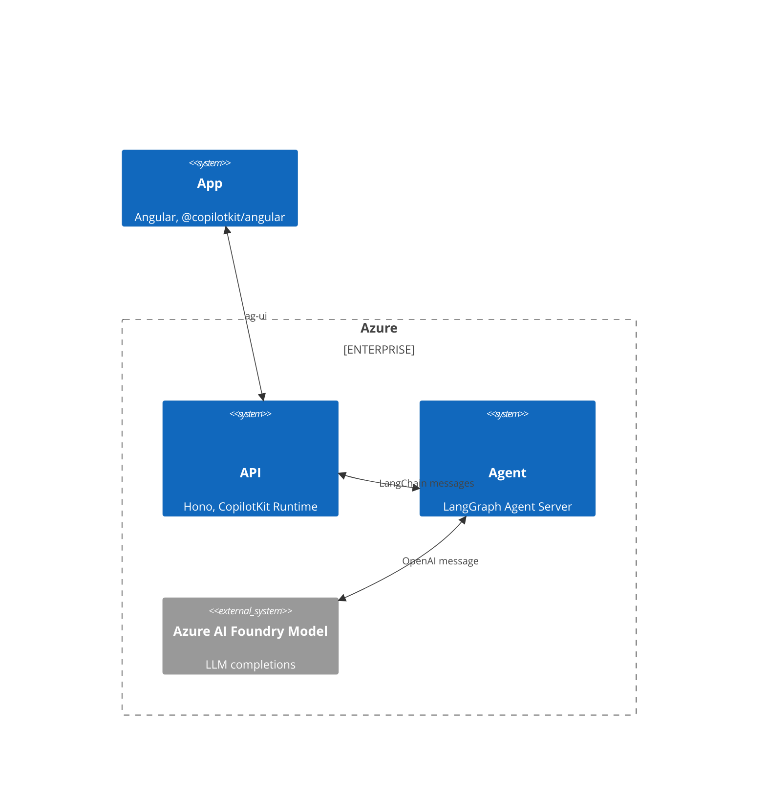
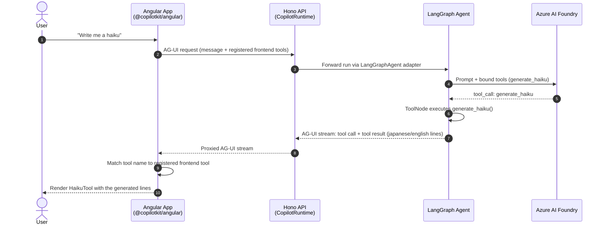
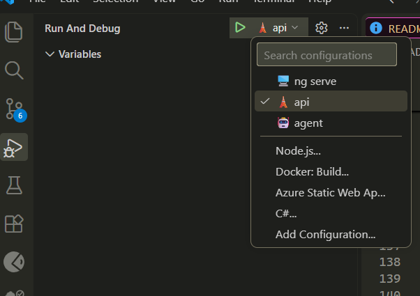
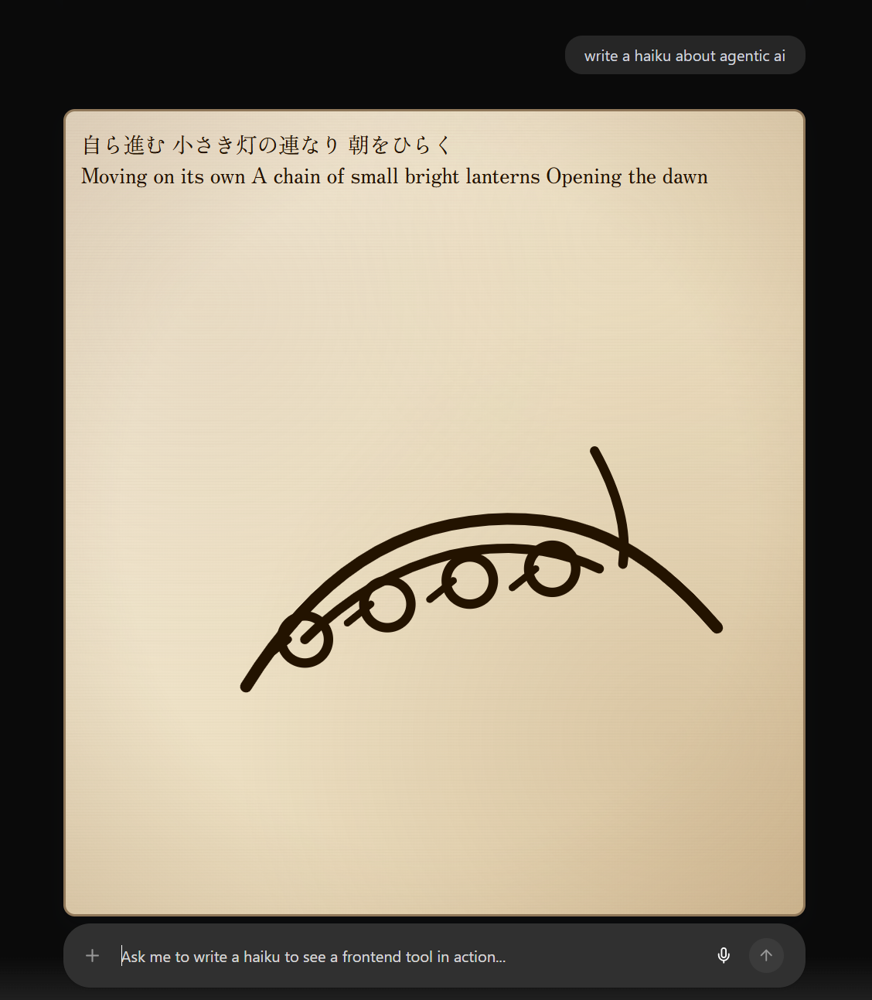
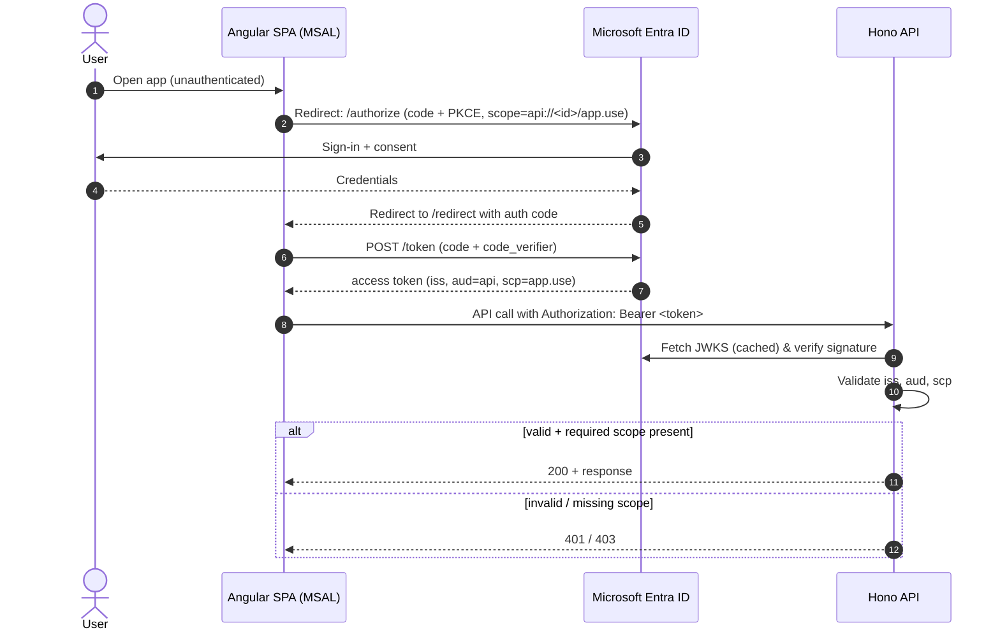

# LangChain AG-UI Angular

A streaming AI chat application with generative UI tool components, connecting an Angular (`@copilotkit/angular`) frontend to a LangGraph Server via the [AG-UI protocol](https://docs.ag-ui.com/) and `@ag-ui/langgraph` on a Hono API.

This sample demonstrates a fully self-hosted deployment on Azure Container Apps using official AG-UI and CopilotKit packages rather than a custom AG-UI protocol implementation.

- **App** — Angular 22 chat UI ([packages/app](packages/app))
- **API** — Hono gateway that bridges the UI and the agent ([packages/api](packages/api))
- **Agent** — LangGraph agent served via LangGraph.js ([packages/agent](packages/agent), [README](packages/agent/README.md))

Each service runs as its own container on **Azure Container Apps**, backed by Azure
AI Foundry (Cognitive Services) model deployments, an Azure Container Registry,
Key Vault, and Application Insights.

## Table of Contents

- [Architecture](#architecture)
- [AG-UI tool calling example](#ag-ui-tool-calling-example)
- [Prerequisites](#prerequisites)
- [Dev Container Quick Start](#dev-container-quick-start)
- [Local development](#local-development)
- [Cost-Conscious Local Development Setup](#-cost-conscious-local-development-setup)
- [Working with the code](#working-with-the-code)
- [Clean up](#clean-up)
- [User authentication (OpenID Connect)](#user-authentication-openid-connect)
- [LangGraph config profiles](#langgraph-config-profiles)
- [Troubleshooting](#troubleshooting)
- [References](#references)

## Architecture

The core idea: a LangGraph agent, backed by an Azure AI Foundry model deployment,
talks to the browser through the **CopilotKit runtime** (hosted in the Hono API)
and the **CopilotKit Angular** client, using the **AG-UI protocol** as the wire
format between the App and the API.

### Infra


### System design



- **App** — Angular UI using `@copilotkit/angular`. Renders the chat, streams
  assistant messages, and registers **frontend tools**. Custom Angular
  components are rendered inline for specific tool calls (for example, the haiku frontend tool included in the demo app).
- **API** — a Hono server hosting the `CopilotRuntime` from `@copilotkit/runtime`.
  It terminates the **AG-UI protocol** from the App and forwards the
  conversation to the LangGraph deployment via `@ag-ui/langgraph`'s
  `LangGraphAgent` adapter (see [app.ts](packages/api/src/app.ts)).
- **Agent** — a LangGraph.js graph ([agent.ts](packages/agent/src/agent.ts)) that
  calls an Azure AI Foundry model deployment and can invoke tools, some of
  which (like `generate_haiku`) are rendered by a matching frontend tool
  component instead of plain text.

## ag-ui tool calling example

Walkthrough of a user prompt that triggers the `generate_haiku` tool and how the
result is rendered by a custom Angular component. Auth (Entra ID) is omitted for
clarity — see [User authentication](#user-authentication-openid-connect) below.



Adding a new tool the same way means: define the tool schema in `packages/schemas`,
bind the tool to the model in [agent.ts](packages/agent/src/agent.ts), and register a
matching Angular component with `registerRenderToolCall` in
[chat.ts](packages/app/projects/demo/src/app/chat/chat.ts)
using the same tool `name`.

### Deployed infrastructure

In Azure, App/API/Agent each run as their own **Container App** behind an
**Application Gateway**, with PostgreSQL, Redis, Key Vault, and Azure AI
Foundry reachable only via private endpoints inside a VNet. See
[infra/main.bicep](infra/main.bicep) for the full topology.

## Prerequisites

- Azure subscription with access to Azure OpenAI.
- Git.
- [LangSmith API key](https://docs.smith.langchain.com/administration/how_to_guides/organization_management/create_account_api_key) from an account with LangGraph Cloud access (free tier works). `azd up` will prompt for it as `LANGSMITH_API_KEY`.
- **Service management reference (optional)** — `azd up` also prompts for `serviceManagementReference`. Press Enter to leave it blank unless your organization requires a service-management reference on Entra app registrations. If it does, get the value from your service owner or identity administration team; do not invent one. See the [Microsoft Graph application properties](https://learn.microsoft.com/en-us/graph/api/resources/application?view=graph-rest-1.0#properties) for the property definition. To avoid the prompt, create the environment first with `azd env new <name>`, then run `azd env set AZURE_SERVICE_MANAGEMENT_REFERENCE <value>`.

## Dev Container Quick Start

[](https://vscode.dev/redirect?url=vscode://ms-vscode-remote.remote-containers/cloneInVolume?url=https://github.com/JayChase/langchain-ag-ui-angular)

- Use the badge above (VS Code Dev Containers) OR create a Codespace.
- Wait for the container to build and install dependencies.
- Sign in

```bash
azd config set auth.useAzCliAuth true
az login
```

- Provision the infra and deploy the apps

```bash
azd up
```

## Local development

### Requirements

- [Azure Developer CLI (`azd`)](https://aka.ms/azd)
- [Azure CLI](https://learn.microsoft.com/en-us/cli/azure/install-azure-cli?view=azure-cli-latest)
- [Node.js](https://nodejs.org/) 24+
- [pnpm](https://pnpm.io/) 10+
- [Docker](https://www.docker.com/products/docker-desktop/) (if building images locally)
- [LangGraph CLI](https://docs.langchain.com/langsmith/cli)

This repo is set up to use [Visual Studio Code](https://code.visualstudio.com/) and GitHub Copilot but it is not essential.

### Set up

- Get the code

```bash
git clone https://github.com/JayChase/langchain-ag-ui-angular.git
cd langchain-ag-ui-angular
```

- Install the dependencies

```bash
pnpm i
```

- Sign in once with Azure CLI

```bash
azd config set auth.useAzCliAuth true
az login
```

- Provision the infra and deploy

```bash
azd up
```

## 💰 Cost-Conscious Local Development Setup

Minimal mode is a lower-cost option for local development. It provisions the
Azure services needed to run the Agent, API and App locally, while skipping more
expensive application-hosting and production infrastructure. It is **not** a
production deployment or production-ready architecture, and it is not free:
Azure AI usage can still incur charges. Use the full deployment for production.

| Minimal mode keeps for local development | Full deployment only |
| --- | --- |
| Azure AI resource and consumption-based model | Application Gateway, public IP, demo certificate generation |
| Entra API/SPA registrations and developer AI access | Container Apps/environment, ACR, managed identities |
| Resource group | PostgreSQL, Redis, VNet, private endpoints/DNS, Key Vault, certificate storage, monitoring stack |

This project runs a separate LangGraph development server. It uses local
development storage, so minimal mode does **not** provision PostgreSQL or Redis.
The omitted monitoring stack includes Application Insights, Log Analytics,
the dashboard and Azure Monitor Private Link Scope (AMPLS).

### Set up and provision

Install the dependencies from the repository root if you have not already:

```bash
pnpm i
```

Create a **new** azd environment and opt into minimal mode:

```bash
azd env new langchain-minimal
azd env set MINIMAL true
```

Configure azd to use Azure CLI authentication, then sign in:

```bash
azd config set auth.useAzCliAuth true
az login
```

Provision the resources:

```bash
azd provision
```

When azd prompts, select the intended subscription, primary region, and model
region. You normally select a subscription in this prompt; you do **not** need to
look up or manually enter its ID.

> **Recovering an existing environment:** If an environment already has
> deployment outputs but its saved subscription setting is missing, restore the
> exact subscription used by that deployment before retrying. The provisioning
> hook reads existing AI firewall rules from that subscription, so do not
> substitute the Azure CLI's current default subscription.
>
> ```bash
> azd env set AZURE_SUBSCRIPTION_ID <original-subscription-id> --environment langchain-minimal
> ```

You need Azure AI model access and quota, Azure resource/RBAC permissions, and
the Microsoft Graph permissions required to create the Entra registrations.
Node.js 24+ is required for the cross-platform provisioning hooks. Have your
LangSmith API key ready for the `LANGSMITH_API_KEY` provisioning input.

### Provisioning behavior

- On a fresh environment, project `preprovision` runs **before** azd selects the
  subscription. It discovers your public IPv4 address using `set-my-ip` without
  querying Azure resources or choosing an implicit Azure CLI subscription.
- Later provisions read and preserve existing AI firewall rules in the selected
  subscription, adding your current IP to the allowlist.
- Postprovision generates local Angular configuration and Agent/API `.env`
  files. No cloud application resources are deployed in minimal mode.
- `MINIMAL` defaults to `false`, so existing full deployments keep their
  architecture and `azd up` workflow. Minimal mode supports **`azd provision`**
  only; hooks reject `azd up`, `azd package`, `azd deploy`, and `azd publish`
  with local-run guidance.

### Restricted local access

Azure AI uses a public service endpoint restricted to your discovered public
IPv4 address and any preserved IP rules. It does not enable an "all Azure
services" exception or an internet-wide IP range. Foundry keeps default action
**Deny** and bypass **None**.

After provisioning, assign your user to the provisioned enterprise applications
and grant the required consent as described under
[User authentication](#user-authentication-openid-connect).

Re-run `azd provision` if your public IP changes. Review and remove obsolete
Foundry IPs in the portal when no longer needed. The preprovision hook aborts on
firewall read errors rather than resetting the allowlist. Do not edit rules
concurrently with provisioning or broaden them to the entire internet to resolve
a timeout.

### Run the Agent, API and App

The local Agent authenticates to Azure AI using `DefaultAzureCredential` and
your Azure CLI login, not a cloud managed identity. From the repository root,
start the Agent:

```bash
pnpm agent
```

In another terminal, start the API with local environment loading enabled:

```bash
pnpm api:minimal
```

In a third terminal, start the App:

```bash
pnpm app
```

Open **https://localhost:4200**, sign in, and ask for a haiku. The generated
frontend configuration points to `http://localhost:4000/api`, and the API
connects to the local Agent at `http://localhost:2024`. Entra sign-in and API
token/scope validation remain enabled.

LangGraph's development server uses local storage, not Azure PostgreSQL or
Redis. Treat it as development state, not production-backed durable history.
See the [LangGraph local development
documentation](https://docs.langchain.com/langsmith/local-dev-testing) for
storage and restart behavior.

### Local credentials and regeneration

Postprovision writes the Agent and API settings to ignored
`packages/agent/.env` and `packages/api/.env`, and creates the ignored Angular
environment files. Protect `.azure/` and the package `.env` files as credentials:
do not commit or publish their contents. The LangSmith key belongs in the
Agent configuration, never the frontend.

To regenerate local configuration from an already provisioned environment:

```bash
azd hooks run postprovision -e langchain-minimal
```

This overwrites the generated Angular environment files and known Agent/API
configuration values, clears stale cloud identity, telemetry and database
settings managed by the minimal helper, and preserves unrelated `.env`
settings.

### Costs

Minimal mode is **not free**: Azure AI charges depend on model usage. It creates
no PostgreSQL or Redis server to stop or start. Any existing full deployment
continues billing independently until you remove it.

### Existing deployments and rollback

Do not treat `MINIMAL=true` as a cleanup operation on an existing full
environment. Incremental ARM deployments do not delete resources omitted by a
conditional module. Use separate environments for the two modes; in-place mode
switching is blocked.

A new azd environment does not guarantee a new Azure resource group. Check the
intended subscription and resource group before provisioning, and restore lost
deployment state rather than reusing an existing deployment.

Verify the new environment first, preserve any history you need, and separately
approve removal of the old environment. Keep the old environment for rollback
until the new setup is accepted. `azd down` is destructive and still does not
remove the Entra app registrations; see [Clean up](#clean-up).

## Working with the code

### Project structure

```text
azure.yaml            # azd service + hook definitions
infra/                 # Bicep infrastructure (Container Apps, ACR, AI Foundry, Key Vault, monitoring)
packages/
  agent/               # LangGraph agent server  (LangGraph.js)
  api/                 # ag-ui api (Hono)
  app/                 # ag-ui app (Angular with @copilotkit/angular)
```

> [!IMPORTANT]
> Warning: the demo certificate under `infra/cert/agw-demo-cert.crt` is for non-production/testing use only and must not be used in production.

### Running and debugging

- Start the agent and api using the debug launch settings



- Run the Angular app

```bash
pnpm app
```

> [!NOTE]
> azd up will add the local ip address as an allowed address to the Azure Foundry instance but if you do not have a static ip address you may need to add your current address as well.

### Using the app

- Open the app **https://localhost:4200** and log in with your Entra account.
- To run the example frontend tool (**haiku tool**), ask the agent to write a haiku.



## Clean up

Remove all the deployed resources and select **Yes** when prompted to permanently delete soft-deleted resources.

```bash
azd down
```

> [!NOTE]
> Run `azd down` without the `--purge` flag and confirm the purge interactively when prompted. Passing `--purge` directly on the command line causes `azd` to force-delete the Log Analytics workspace before the resource group is removed, which fails with `CannotDeleteWorkspaceWhenLinkedToPrivateLinkScopes` while the Azure Monitor Private Link Scope is still attached.
> [!WARNING]
> azd provision will deploy resources on paid SKUs. So please do not leave these running if you are not using them. They will cost you money.
> [!WARNING]
> azd down will not remove the Entra app registrations. Please delete those manually.

## User authentication (OpenID Connect)

User sign-in is handled by **Microsoft Entra ID** using the OAuth 2.0 authorization
code flow with PKCE. Two app registrations are provisioned by Bicep:

- **API registration** ([infra/api-registration.bicep](infra/api-registration.bicep)) —
  exposes the delegated scope `app.use` under an app ID URI
  (`api://<clientId>`). This is the token _audience_ the API expects.
  `appRoleAssignmentRequired` is set so only users/groups explicitly assigned to
  the app in Entra can obtain tokens for it.
- **App registration** ([infra/app-registration.bicep](infra/app-registration.bicep)) —
  a _public client_ for the Angular SPA (no client secret). It is granted the
  API's `app.use` scope and has the local dev redirect URI
  (`https://localhost:4200/redirect`). Full mode also adds the deployed gateway
  redirect URI (`https://<agw-public-ip>/redirect`).



### App (Angular with [msal-angular](https://github.com/AzureAD/microsoft-authentication-library-for-js/tree/dev/lib/msal-angular))

[auth.config.ts](packages/app/projects/demo/src/app/auth.config.ts) wires up
`@azure/msal-angular`:

- **Interaction type: redirect** (not popup) — works reliably across browsers and
  with SSR.
- **Token cache: session storage** — tokens do not survive a browser restart.
- **`MsalGuard`** protects app routes; unauthenticated users are redirected to
  Entra and land back on `/redirect` after sign-in.
- **`MsalInterceptor`** silently acquires and attaches an access token to any
  request whose URL matches the API URI in the `protectedResourceMap`.

The `clientId`, authority, and API scopes come from the environment files, which
are populated from the `azd` outputs (`NG_APP_CLIENT_ID`, `NG_ENTRA_AUTHORITY`,
`NG_API_SCOPES`) — so local and deployed configs always match the provisioned
registrations.

### Server side (API)

[bearer-auth.ts](packages/api/src/middleware/bearer-auth.ts) validates every
incoming request using `hono/jwk`:

- **Signature** — verified against Entra's JWKS endpoint (`RS256`).
- **`iss`** — must be `https://login.microsoftonline.com/<tenantId>/v2.0`.
- **`aud`** — must be the API registration's identifier URI.
- **`scp`** — must contain `app.use`; a missing scope returns `403` (an invalid
  or expired token returns `401`).

Validated claims (`sub`, `tid`, `scp`) are stored on the request context as
`authContext`, so downstream handlers can identify the caller.

## LangGraph config profiles

The agent package uses explicit LangGraph config profiles:

- `packages/agent/langgraph.local.json` — local development profile
- `packages/agent/langgraph.deploy.json` — deployment profile
  - currently matches local profile persistence behavior

Agent scripts are pinned to profiles so they cannot be mixed up accidentally:

- `pnpm --filter agent run dev` (alias of `dev:local`) uses `langgraph.local.json`
- `pnpm --filter agent run dev:deploy` uses `langgraph.deploy.json`
- `pnpm --filter agent run create-dockerfile` uses `langgraph.deploy.json`

## Troubleshooting

- **`failed logging into container registry` (401) right after `azd provision`** —
  the deployer's RBAC role assignment on the Container Registry can take a few
  minutes to propagate. Re-run `azd deploy` after a short wait; no infrastructure
  change is needed.
- **`ServiceTreeValueNotGuid: Value for ServiceManagementReference must be a valid GUID`** when creating the app registrations —
  your tenant requires a service-management reference (a Service Tree GUID in Microsoft-internal tenants). Get the approved value from your service owner, then run `azd env set AZURE_SERVICE_MANAGEMENT_REFERENCE <guid>` and re-run `azd up`. See the [troubleshooting guide](https://aka.ms/service-management-reference-error) (requires access to Microsoft-internal documentation).
- If you are using **Git Bash** for Windows as your terminal, **AZD** will try to run the PowerShell hook script. To fix this, manually change the windows scripts to the posix versions in the [azure.yaml](./azure.yaml) file.

### Debugging the deployed environment

Every resource that matters (PostgreSQL, Redis, Key Vault, Azure AI Foundry) sits
behind private endpoints inside the VNet ([infra/vnet.bicep](infra/vnet.bicep)),
so it isn't reachable from your machine. [main.bicep](infra/main.bicep) has an
optional `terminal` container app for reaching those endpoints from inside the
network.

- Deploy it by setting the `deployTerminal` parameter to `true`:
  run `azd env set DEPLOY_TERMINAL true` and then `azd provision`.
- It is preloaded with the same connection secrets as the agent container:
  `DATABASE_URI` (Postgres), `REDIS_URI`, and `AZURE_AI_ENDPOINT`, plus
  `LANGSMITH_API_KEY` when set — so you can test connectivity with the exact
  values the agent uses, without copy-pasting secrets out of Key Vault.
- It runs the [`nicolaka/netshoot`](https://github.com/nicolaka/netshoot) image
  (dig, curl, psql client tooling, etc.) with `disableIngress: true` — it has no
  public endpoint and can only be reached via the Container Apps console in Azure portal or using the **az containerapp**:

```bash
az containerapp exec \
  --name <abbrs.appContainerApps>terminal \
  --resource-group <abbrs.resourcesResourceGroups><environmentName> \
  --command /bin/bash
```

> [!WARNING]
> The terminal container app has no ingress but still runs 24/7 once deployed —
> set `deployTerminal` back to `false` and redeploy when you're done to avoid
> paying for an idle container.

## References

- [Angular CopilotKit](https://docs.copilotkit.ai/angular)
- [Self hosted LangChain Agent Servers](https://docs.langchain.com/langsmith/deploy-standalone-server)
- [LangGraph AG-UI](https://github.com/ag-ui-protocol/ag-ui#readme)
- [azd](https://learn.microsoft.com/en-gb/azure/developer/azure-developer-cli/overview?tabs=linux)
- [Azure Database for PostgreSQL](https://learn.microsoft.com/en-us/azure/postgresql/)
- [Azure Managed Redis](https://learn.microsoft.com/en-us/azure/redis/)
