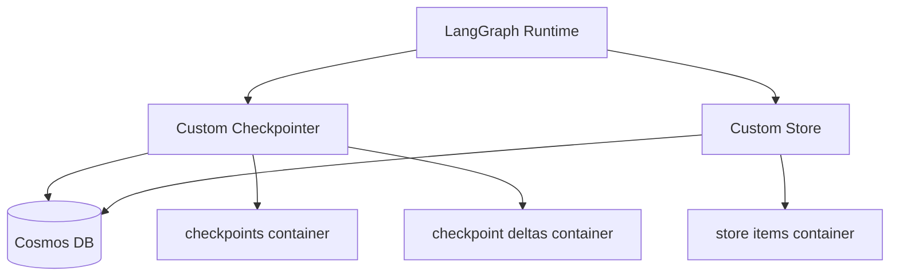

# Cosmos Checkpointer and Store for LangGraph Agent Server

This document explains how to implement and operate a custom Azure Cosmos DB checkpointer and store for a LangGraph Agent Server, based on the implementation in this repository.

## Why this exists

This project uses:

- A custom checkpointer for LangGraph persistence
- A custom long-term store for LangGraph memory
- Azure Cosmos DB for both of the above

This gives you a single cloud-native persistence layer for checkpoint snapshots, checkpoint deltas, and store data.

## High-level architecture



## Repository wiring points

The following files are the key integration points:

- LangGraph deploy profile: `packages/agent/langgraph.deploy.json`
- Checkpointer implementation: `packages/agent/src/cosmos-checkpointer.ts`
- Store implementation: `packages/agent/src/cosmos-store.ts`
- Environment schema: `packages/agent/models/settings.ts`
- Env template: `packages/agent/.env.example`
- Infrastructure definition: `infra/main.bicep`

## 1) LangGraph config: enable custom backends

In `packages/agent/langgraph.deploy.json`, wire custom checkpointer and store:

```json
{
  "checkpointer": {
    "backend": "custom",
    "path": "./src/cosmos-checkpointer.ts:generateCheckpointer"
  },
  "store": {
    "path": "./src/cosmos-store.ts:generateStore"
  }
}
```

## 2) Environment variables

Use these variables in `packages/agent/.env`:

```dotenv
COSMOS_ENDPOINT=<your-cosmos-endpoint>
COSMOS_DATABASE_NAME=agentDb
STORE_COSMOS_CONTAINER_NAME=<your-store-cosmos-container-name>
CHECKPOINT_DELTAS_COSMOS_CONTAINER_NAME=<your-checkpoint-deltas-cosmos-container-name>
CHECKPOINTS_COSMOS_CONTAINER_NAME=<your-checkpoints-cosmos-container-name>
```

The schema is defined in `packages/agent/models/settings.ts` and provides defaults:

- `STORE_COSMOS_CONTAINER_NAME` -> `store_items`
- `CHECKPOINT_DELTAS_COSMOS_CONTAINER_NAME` -> `checkpoint_writes`
- `CHECKPOINTS_COSMOS_CONTAINER_NAME` -> `checkpoints`

## 3) Checkpointer implementation details

The checkpointer uses two containers:

- `checkpoints`: committed checkpoint snapshots
- `checkpoint deltas`: per-step or per-task write deltas used to reconstruct pending writes

Factory wiring (`generateCheckpointer`) should pass env-based names:

```ts
return CosmosDBCheckpointSaver.fromEndpoint({
  endpoint,
  databaseName,
  checkpointsContainerName,
  writesContainerName,
});
```

Container usage pattern:

- `put(...)` writes checkpoint snapshots
- `putWrites(...)` writes pending deltas
- `getTuple(...)` reads a snapshot and joins pending deltas
- `list(...)` reads checkpoint history and related deltas

## 4) Store implementation details

The store uses one container for long-term memory items.

Factory wiring (`generateStore`) should pass env-based container name:

```ts
return CosmosDBStore.fromEndpoint({ endpoint, databaseName, containerName });
```

The store implementation supports:

- get
- put/delete
- filtered search
- list namespaces

## 5) Cosmos container model used in this repo

The infrastructure currently defines three containers in the same database:

- checkpoints
- checkpoint deltas
- store items

Recommended partition keys:

- checkpoints: `/threadId`
- checkpoint deltas: `/threadId`
- store items: `/namespaceKey`

In this repo, these are configured in `infra/main.bicep` under `sqlDatabases[].containers`.

## 6) Minimal implementation checklist

1. Create the three Cosmos containers.
2. Add env vars to `.env` and `.env.example`.
3. Parse env vars in `models/settings.ts`.
4. Pass container names from settings into `generateCheckpointer()` and `generateStore()`.
5. Wire custom paths in `langgraph.deploy.json`.
6. Run deploy profile locally to validate behavior.

## 7) Local validation

From repository root:

```bash
pnpm --filter agent run dev:deploy
```

Expected behavior:

- Agent starts with deploy profile
- Checkpointer and store factories resolve
- Cosmos containers are used based on env var names

## 8) Operational guidance

- Keep container names configurable via env (already implemented).
- Keep partition keys aligned with query patterns.
- Use TTL where appropriate for short-lived delta data.
- Start with conservative RU and tune from telemetry.

## References

### Repository references

- `packages/agent/langgraph.deploy.json`
- `packages/agent/src/cosmos-checkpointer.ts`
- `packages/agent/src/cosmos-store.ts`
- `packages/agent/models/settings.ts`
- `packages/agent/.env.example`
- `infra/main.bicep`

### External references

- LangGraph JS docs: https://langchain-ai.github.io/langgraphjs/
- LangGraph persistence concepts: https://langchain-ai.github.io/langgraph/concepts/persistence/
- Azure Cosmos DB for NoSQL docs: https://learn.microsoft.com/azure/cosmos-db/nosql/
- Azure Cosmos DB partitioning guidance: https://learn.microsoft.com/azure/cosmos-db/partitioning-overview
