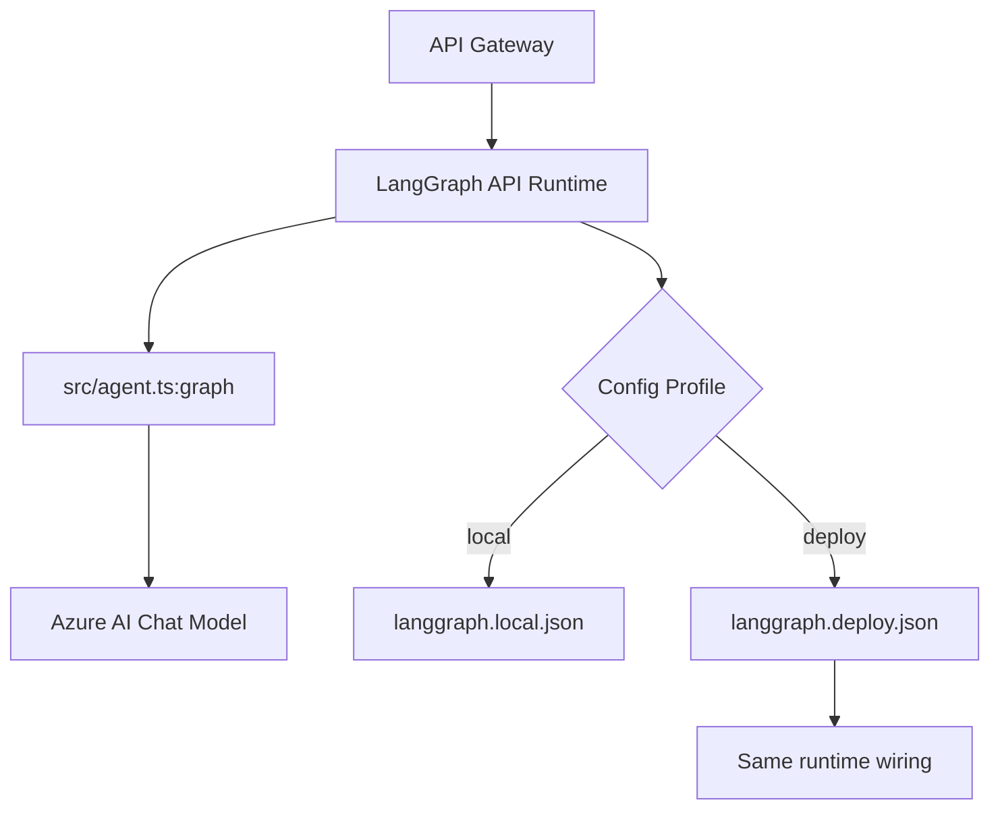

# Agent Service

LangGraph.js agent service for the LangChain AG-UI Angular workspace.

This package defines and serves the agent graph used by the API gateway. It supports
separate local and deployment LangGraph runtime profiles.

## What This Service Does

- Defines a LangGraph workflow in `src/agent.ts`
- Calls Azure AI chat models through `@langchain/openai`
- Exposes graph entrypoints via LangGraph.js API runtime

## Architecture



## Key Files

- `src/agent.ts` - graph definition and model/tool orchestration
- `models/settings.ts` - environment parsing via Zod
- `langgraph.local.json` - local LangGraph profile
- `langgraph.deploy.json` - deploy LangGraph profile

## Profiles

### Local profile

`langgraph.local.json` is used for local development.

Behavior:

- Runs graph with default runtime persistence wiring

### Deploy profile

`langgraph.deploy.json` is used for deployment-oriented runtime behavior.

Behavior:

- Runs graph with default runtime persistence wiring

## Environment Variables

This package reads settings via `models/settings.ts` (`EnvSchema`).

Required for baseline runtime:

- `CHAT_MODEL_NAME`
- `AZURE_AI_ENDPOINT`

Optional model tuning:

- `AZURE_AI_API_VERSION`
- `TEMPERATURE`
- `MAX_TOKENS`

Reference template: `.env.example`

## Commands

From workspace root:

```bash
pnpm --filter agent run dev
```

This is the local profile (`langgraph.local.json`).

Other useful commands:

```bash
pnpm --filter agent run dev:local
pnpm --filter agent run dev:deploy
pnpm --filter agent run create-dockerfile
pnpm --filter agent run build
pnpm --filter agent run start
```

## Local Development

1. Install dependencies at workspace root:

```bash
pnpm install
```

2. Configure `packages/agent/.env` based on `.env.example`.

3. Start agent with local profile:

```bash
pnpm --filter agent run dev
```

Or use the **.vscode** launch configuration `🤖 agent` to run and debug.

4. If you need to test the deploy profile locally:

```bash
pnpm --filter agent run dev:deploy
```

## Notes

- The graph code itself is profile-agnostic.
- Persistence backend selection is controlled by LangGraph config files, not by graph code.
- For deployment, ensure deploy pipeline uses the deploy profile (`langgraph.deploy.json`).
